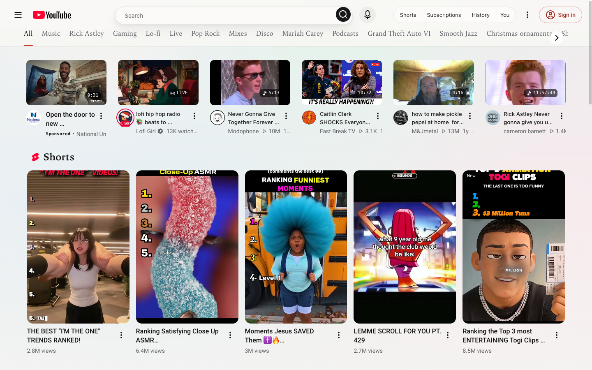
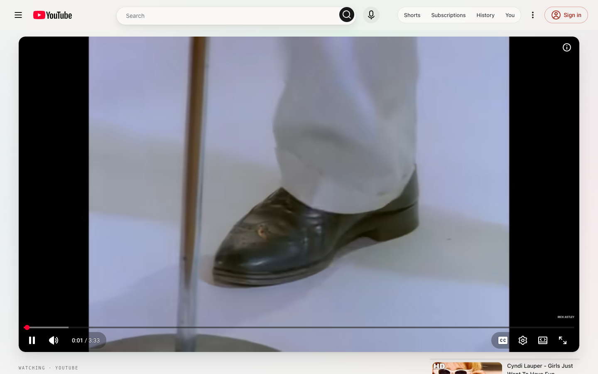
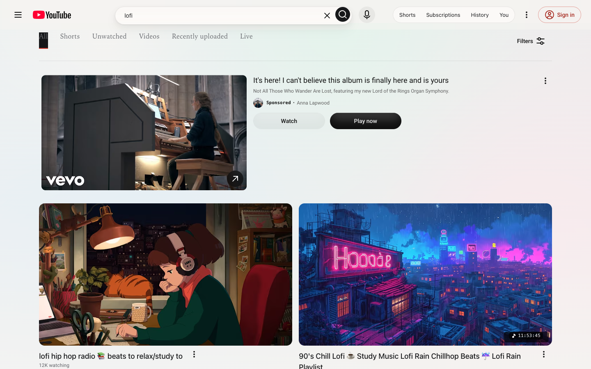
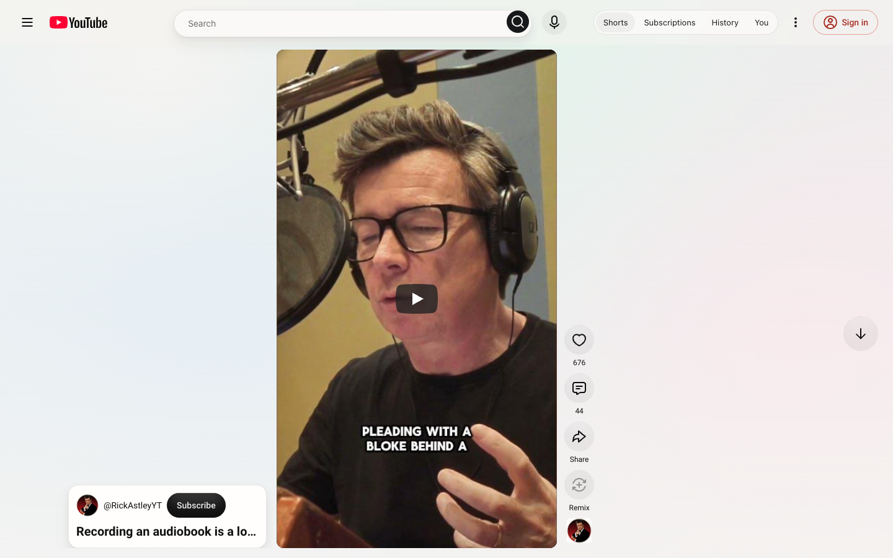
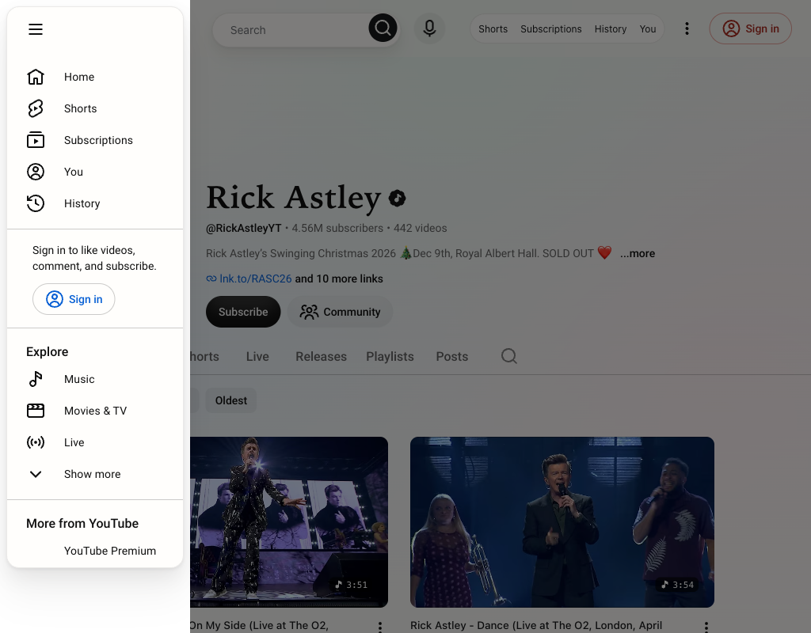

<p align="center">
  
</p>

<h1 align="center">Framefold for YouTube</h1>

<p align="center"><strong>An editorial layout for desktop YouTube.</strong></p>

<p align="center">
  A wider video grid, a focused watch page, and quick navigation for Chrome and Edge.
</p>

<p align="center">
  <a href="https://github.com/yxxbc/framefold-youtube/releases/latest"><strong>Download</strong></a>
  · <a href="#screenshots">Screenshots</a>
  · <a href="#install">Install</a>
  · <a href="#中文说明">中文说明</a>
</p>

<a href="docs/screenshots/home.png">
  
</a>

## What changes

- **Home** uses equal-width video cards and keeps search in the fixed toolbar. On newer browsers, later cards can fill gaps before full-width shelves.
- **Navigation** frees the space used by the permanent sidebar on desktop windows 900 px and wider. Shorts, Subscriptions, History, and You move to the toolbar. The menu button opens the full guide in a drawer.
- **Watch and Shorts** give video more room. The watch page puts the description, comments, and related videos below the player. Shorts keeps creator details beside the video on wide screens.
- **Search** presents regular videos as thumbnail cards and switches to a single column in narrow windows.
- **Appearance** includes light, dark, and follow-YouTube themes, a glass toggle, and five locally rendered backgrounds.

## Screenshots

<table>
  <tr>
    <th>Watch</th>
    <th>Search</th>
  </tr>
  <tr>
    <td><a href="docs/screenshots/watch.png"></a></td>
    <td><a href="docs/screenshots/search.png"></a></td>
  </tr>
  <tr>
    <th>Shorts</th>
    <th>Navigation drawer</th>
  </tr>
  <tr>
    <td><a href="docs/screenshots/shorts.png"></a></td>
    <td><a href="docs/screenshots/navigation.png"></a></td>
  </tr>
</table>

## Install

1. Download `framefold-youtube-chrome.zip` or `framefold-youtube-edge.zip` from [GitHub Releases](https://github.com/yxxbc/framefold-youtube/releases/latest).
2. Extract the ZIP into a folder.
3. Open `chrome://extensions` or `edge://extensions`, turn on **Developer mode**, then choose **Load unpacked** and select the folder containing `manifest.json`.
4. Open or refresh YouTube. Click the extension icon to change its appearance or turn it off.

The extension targets desktop Chrome and Edge 111+. The wide watch layout uses CSS subgrid. Home row packing with keyboard focus in visual order requires Chromium 137+.

## Develop

Use Node.js 20 or later.

```sh
npm ci
npm run build
```

Load the generated `dist/` directory as an unpacked extension. After rebuilding, reload the extension and refresh YouTube.

| Command | Purpose |
| --- | --- |
| `npm test` | Build, check the package, and launch Chromium with the extension loaded. |
| `npm run test:e2e` | Validate layout and navigation on live YouTube in a graphical Chromium session. |
| `npm run pack` | Produce the Chrome and Edge archives and a test ZIP in `dist/`. |

Install Chromium for Playwright with `npx playwright install chromium` if needed. To use a proxy for the live tests, set `MARGIN_PROXY` to its URL.

## 中文说明

Framefold 是一款适用于 Chrome 和 Edge 的 YouTube 桌面扩展。它把首页推荐整理成等宽卡片，把常用入口移到顶部，并把播放页的简介、评论和推荐放到播放器下方。原生播放器、搜索和账号入口仍可使用。

从 [GitHub Releases](https://github.com/yxxbc/framefold-youtube/releases/latest) 下载对应的 ZIP 并解压。在浏览器扩展管理页打开「开发者模式」，点击「加载已解压的扩展程序」，选择包含 `manifest.json` 的文件夹，然后刷新 YouTube。

[隐私说明](docs/PRIVACY.md) · [与 B 站版映间的源码对照](docs/DESIGN-REFERENCE.md) · [更新记录](CHANGELOG.md)

## Privacy and credits

Appearance preferences are stored through the browser's extension storage. The extension makes no network requests of its own and does not read cookies. See the [privacy policy](docs/PRIVACY.md).

The visual direction and shader backgrounds draw on [MARGIN for Bilibili](https://github.com/jiuyang5354/bilibili-margin). This is an independent project. YouTube and its logo are trademarks of Google LLC. [MIT License](LICENSE).
